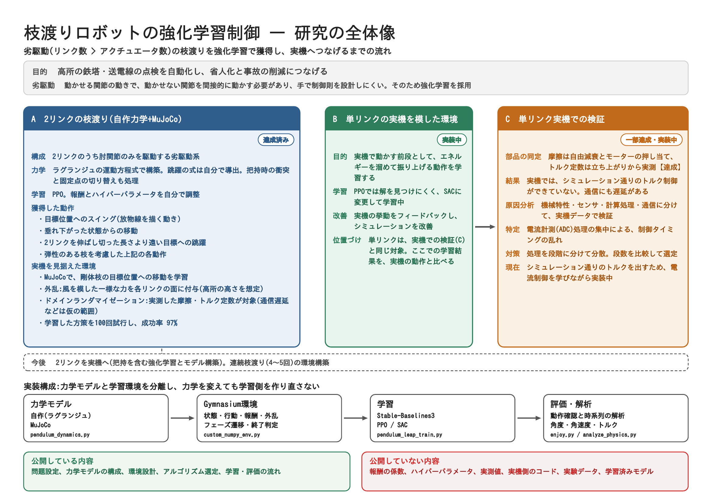

# 枝渡りロボットの強化学習制御(2リンク・MuJoCo / 自作力学)

[](https://www.python.org/)
[](https://gymnasium.farama.org/)
[](https://mujoco.org/)
[](https://stable-baselines3.readthedocs.io/)

テナガザルを模した、劣駆動の枝渡りロボット(2リンク、肘関節のみ駆動)の運動を、深層強化学習(PPO)で獲得する研究のうち、公開できる範囲の実装です。ラグランジュの運動方程式による自作の力学モデルと、MuJoCoの環境を、Gymnasiumの環境として構成しています。

---

## 1. 研究目的

高所の鉄塔や送電線の点検作業を自動化し、省人化と事故の削減につなげることを目的としています。

枝渡りは、リンクの数よりアクチュエータの数が少ない劣駆動系です。動かせる関節の動きで、動かせない関節を間接的に動かす必要があるため、制御則を手で設計しにくく、従来のモデルベース制御では、機械特性の正確なモデル化も必要になります。そこで、外乱やモデル誤差にも対応できる深層強化学習を用いています。

本研究の問いは、次の2点です。

- 劣駆動の枝渡りの運動を、強化学習でどこまで獲得できるか
- シミュレーションで学習した制御を、実機で同じように動かすには、何が壁になるか

## 2. 研究の全体像

<div align="center">
  
</div>

シミュレーションでの動作例(2リンク):

<div align="center">
  
</div>

---

## 3. 研究の段階と現在の状態

| 段階 | 内容 | 状態 |
|---|---|---|
| A | 2リンクの運動獲得(自作力学+MuJoCo) | 達成済み |
| B | 単リンクの、実機を模した環境(SAC) | 実装中 |
| C | 単リンク実機での検証 | 一部達成・実装中 |

### A. 2リンクの運動獲得(達成済み)

- **力学:** ラグランジュの運動方程式で、2リンクの運動方程式を構築しています。跳躍(空中飛行)の運動方程式は、それをもとに構築しました。枝をつかむ際の衝突(撃力)と、固定点の切り替えも、計算で処理しています。
- **学習:** PPO(Stable-Baselines3)を用い、報酬とハイパーパラメータは自分で調整しました。
- **獲得した動作:**
  - 目標位置へのスイング(放物線を描く動き)
  - 垂れ下がった状態からの移動
  - 2リンクを伸ばし切った長さより遠い目標への跳躍
  - ばね・ダンパーで表した弾性のある枝を考慮した、上記の各動作
- **実機を見据えた環境:** MuJoCoで、剛体枝の目標位置への移動を学習する環境を作り、外乱とドメインランダマイゼーションを導入しています。
  - 外乱は、風を直接再現することが難しいため、各リンクの面に、ランダムな面から、高所の鉄塔や送電線の高さを想定した大きさの一様な力を加えて表しています。
  - ドメインランダマイゼーションは、実機で実測して同定した摩擦とトルク定数を対象にしています。通信遅延などは、実機での値が未特定のため、仮の範囲です。
- **成果:** 上記の環境(剛体枝・2リンク・目標位置への移動)で、学習した方策を100回試行し、成功率は **97%** でした。弾性枝の動作は、別の条件での評価で、この数値には含まれません。

### B. 単リンクの実機を模した環境(実装中)

- **目的:** 実機で動かす前段として、エネルギーを溜めて振り上げる動作を学習します。
- **アルゴリズム:** この動作は、PPOの方策勾配法では解を見つけにくかったため、SACに変更しました。なお、SACの学習コードは、このリポジトリには含まれていません。
- **現在:** 実機の挙動をシミュレーションにフィードバックし、シミュレーションを改善しています。

### C. 単リンク実機での検証(一部達成・実装中)

- **現状:** 実機では、シミュレーション通りのトルク制御ができていません。通信にも遅延があります。
- **原因分析:** 要因を、機械特性・センサ・計算処理・通信に分け、実機データで検証しました。その結果、電流計測(ADC)処理の集中によって、制御タイミングが乱れていることを確認しました。
- **対策:** 処理を段階に分けて分散し、段数を比較して選定しました。
- **現在:** シミュレーション通りのトルクを出すため、電流制御を学びながら実装を進めています。

---

## 4. 設計

物理計算と、強化学習の環境(Gymnasium)を分けて実装しています。力学モデルを変えても、学習側を作り直さずに、剛体枝と弾性枝などの条件を、同じ学習の仕組みで比較できます。

| 構成 | 役割 |
|---|---|
| 力学モデル | 自作(ラグランジュ)とMuJoCoの2種類 |
| Gymnasium環境 | 状態・行動・報酬・外乱、フェーズ遷移、終了判定 |
| 学習 | Stable-Baselines3(PPO) |
| 評価・解析 | 動作確認と、角度・角速度・トルクなどの時系列の解析 |

使用技術: Python 3.10+、Gymnasium、Stable-Baselines3、MuJoCo、NumPy、SciPy、Matplotlib

## 5. 使い方

```bash
pip install -r requirements.txt

# 学習(公開版では、報酬の係数とハイパーパラメータを簡略化しています)
python pendulum_leap_train.py

# 動作確認(学習で得たモデルを使います)
python enjoy.py
```

公開版の報酬とハイパーパラメータは、研究で用いた値ではありません。そのため、研究での成功率は再現されません。

## 6. リポジトリ構成

```text
brachiation-project/
├── envs/                           # 環境定義
│   ├── brachiation_env.py          # 標準の物理環境(剛体枝)
│   ├── brachiation_transfer_env.py # 条件を拡張した環境
│   └── hardware_consideration/     # 単リンクの検証用スクリプト(実測値・ゲインは含みません)
├── models/                         # 学習済みモデルの保存先(非公開)
├── ppo_log/                        # 剛体枝モデルの学習ログ
├── logs_hybrid_branch/             # 弾性枝モデルの学習ログ
├── pendulum_dynamics.py            # 力学モデル(剛体枝)
├── custom_numpy_env.py             # Gymnasium環境(弾性枝)
├── pendulum_leap_train.py          # 学習スクリプト(剛体枝、PPO)
├── pendulum_elastic_train.py       # 学習スクリプト(弾性枝)
├── enjoy.py                        # 動作確認(剛体枝)
├── enjoy_elastic.py                # 動作確認(弾性枝)
├── analyze_physics.py              # 物理量の解析(剛体枝)
└── analyze_physics_elastic.py      # 物理量の解析(弾性枝)
```

## 7. 公開範囲について

研究を継続中のため、次の内容は公開していません。

- 報酬の係数、ハイパーパラメータ
- 実測して同定した値
- 学習済みモデル、実験データ、実験の動画
- 実機側の制御コード

公開しているのは、問題設定、力学モデルの構成、環境の設計、アルゴリズムの選定、学習と評価の流れです。このリポジトリの目的は、研究の結果をそのまま再現できる形で出すことではなく、どのような問題設定と環境設計で、どのように課題へ取り組んでいるかを示すことです。

## 8. 今後

- 2リンクを実機へ移す(把持を含む強化学習と、モデルの構築)
- 連続して枝を渡る環境の構築(4〜5回の連続移動)