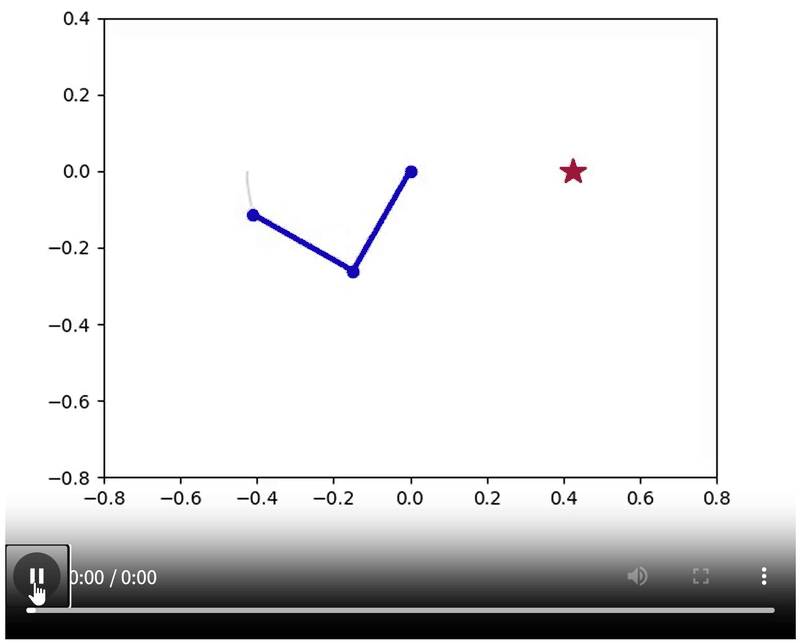
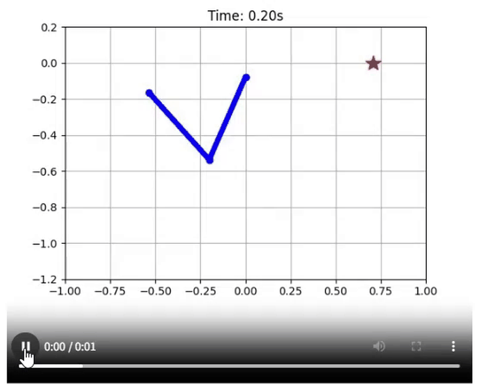
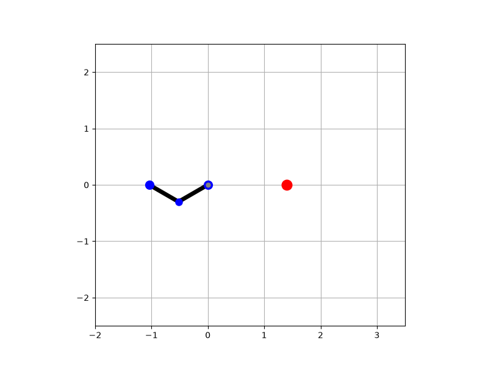
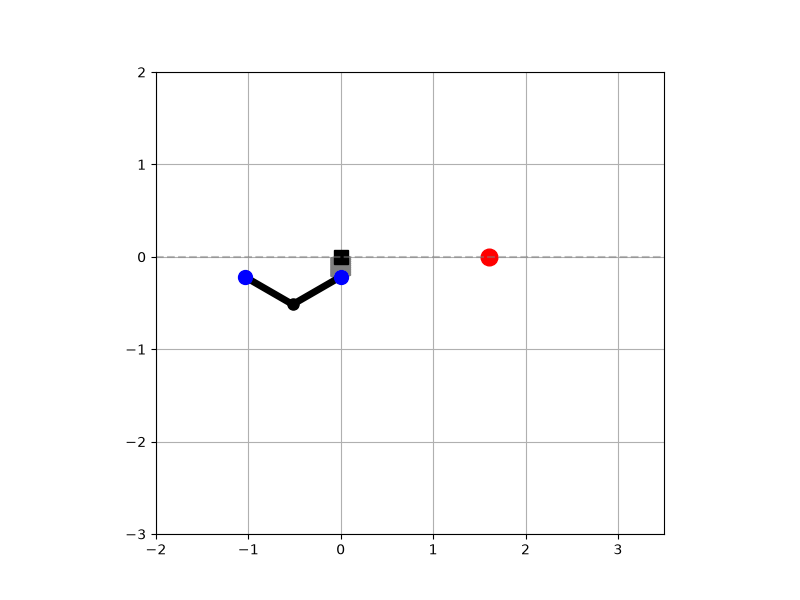
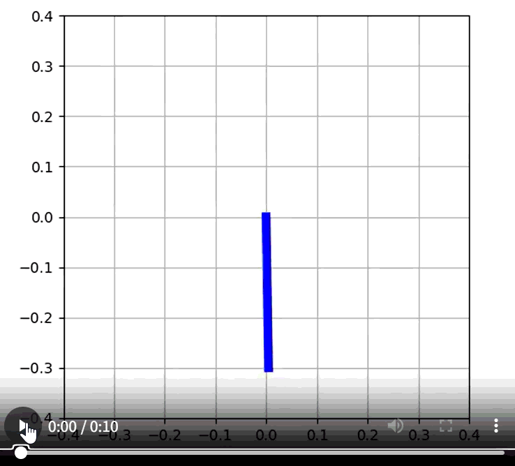

# 枝渡りロボットの強化学習制御
**自作力学モデルによる跳躍動作の獲得と実機への制御適用に向けた検証**

テナガザルのように腕を振って移動する、劣駆動の枝渡りロボットを対象に、深層強化学習による運動の獲得と、実機への制御適用に向けた検証に取り組んでいます。

研究の目的は、高所の鉄塔や送電線の点検作業を自動化し、省人化と事故の削減につなげることです。2リンクロボットの力学モデルと強化学習環境を構築し、目標位置へのスイングや跳躍動作を獲得しました。また、単リンク実機の制御検証では、電流計測処理による制御タイミングの乱れを特定し、処理構成の改善に取り組んでいます。


## 1. 主な成果

- **2リンクの運動獲得：** 自作の力学モデルを用いて、目標位置へのスイング、垂れ下がった状態からの移動、跳躍動作を獲得
- **目標位置への移動：** 剛体枝の2リンクモデルによるシミュレーションで、100回中97回の成功を確認
- **実機の制御タイミング改善：** ADC処理の分割により、比較した条件で最大処理時間を103 µsから45 µsに短縮し、タイミングのばらつきを65 µsから8 µsに低減
- **実機への適用：** 単リンク実機で制御上の課題を分析し、電流フィードバック制御の実装と調整を継続中

※97%は、剛体枝の2リンクモデルによる目標位置への移動タスクの結果です。跳躍動作や実機制御の成功率ではありません。また、処理時間とタイミングのばらつきは、比較した処理構成における結果であり、実機のトルク制御が完成したことを示すものではありません。

## 2. 研究の全体像


研究は、2リンクロボットの運動獲得、単リンクの実機模擬環境での学習、単リンク実機での制御検証を中心に進めています。

| 段階 | 取り組み | 状態 |
|---|---|---|
| A | 2リンクの運動獲得・評価（自作力学モデル、MuJoCo） | 主要なシミュレーション動作を獲得・評価済み |
| B | 単リンクの実機模擬環境での振り上げ学習 | SACによる学習環境を実装中 |
| C | 単リンク実機での制御検証 | 制御タイミングの課題を特定し、改善中 |
| D | グリッパー付きモデルへの拡張 | 摩擦特性の同定段階 |

A・B・Cは対象とするモデルや制御系が異なります。2リンクのシミュレーションで得られた結果と、単リンク実機での検証結果を区別して評価しています。

## 3. シミュレーションで獲得した動作

### 3.1 目標位置へのスイング

振り運動で得たエネルギーを利用して目標位置へ移動し、到達時の速度を抑える動作を学習しています。

**剛性枝での目標位置へのスイング**



**弾性枝での目標位置へのスイング**



### 3.2 跳躍動作

自作の力学モデルを用いて、枝を離れて空中を移動する跳躍動作を扱っています。枝をつかむ際の衝突や支持点の切り替えを計算上で扱い、枝の弾性を考慮した条件でも動作を検証しています。

**剛性枝を想定したモデルでの跳躍**



**弾性枝を想定したモデルでの跳躍**



### 3.3 単リンクの振り上げ

実機への移行を見据え、単リンクロボットがエネルギーを蓄えて振り上がる動作についても学習環境を構築しています。PPOでは学習が進みにくかったため、SACに変更して実装を進めています。



※掲載動画はシミュレーション上の動作例です。実機での再現や、把持を含む枝渡りタスク全体の成功を示すものではありません。

## 4. 技術的な取り組み

### A. 2リンクロボットの運動獲得と評価

#### 力学モデルの構築

ラグランジュの運動方程式に基づいて2リンクの運動方程式を構築し、跳躍時の空中運動も実装しました。枝をつかむ際の衝突と支持点の切り替えも計算上で扱っています。枝の弾性は、ばね・ダンパーによってモデル化しています。

#### 強化学習による動作の獲得

Stable-Baselines3のPPOを用いて学習し、報酬設計とハイパーパラメータの調整を行いました。主に次の動作を獲得しています。

- 目標位置へのスイング
- 垂れ下がった状態からの移動
- 2リンクを伸ばし切った長さより遠い目標への跳躍
- 弾性枝を考慮した動作

#### MuJoCoでの目標位置への移動制御

実機への移行を見据え、MuJoCo上に2リンクロボットの制御環境を構築しました。駆動するのは肘関節のみで、目標位置への移動と到達時の静止を目指します。

観測には関節角度の正弦・余弦と角速度を用い、行動は肘関節に加えるトルクとしています。

#### 実機パラメータの同定

2リンクロボットを用いて、モーターのトルク定数と関節の摩擦特性を推定しました。

- **トルク定数：** 電流と荷重の測定値の関係を最小二乗法で回帰して推定
- **摩擦特性：** ロボットを剛体振り子とみなし、OptiTrack（120 Hz）で計測した減衰運動から機械的エネルギーの損失量を求め、粘性摩擦係数とクーロン摩擦係数を最小二乗法で推定

摩擦特性は第1関節側と第2関節側でそれぞれ5回測定し、平均値を用いました。同定したパラメータ値は公開していません。

#### 外力とパラメータ変動への対応

リンク長、質量、粘性摩擦係数、クーロン摩擦係数を変動させ、各リンクにランダムな方向から外力を加えた条件で方策を評価しました。外力は風そのものを直接再現したものではなく、高所での使用を想定した一様な力による近似です。

また、初期角度と初期角速度を変動させ、学習時より広い初期状態の範囲でも目標位置への到達可否を評価しました。

#### 目標位置への移動タスクの評価

剛体枝の2リンクモデルによる目標位置への移動タスクでは、100回の試行中97回で成功しました（成功率97%）。

成功条件は、手先と目標位置の誤差が0.01 m未満、かつ到達時の手先速度が0.15 m/s未満であることです。この結果は設定したシミュレーション条件下での移動タスクに対するものであり、実機での成功率や、把持を含むタスクの成功率ではありません。

さらに、上記の100回試行とは別に、評価用の初期状態範囲から600点をサンプリングして到達可否を調べました。その結果、可動域の境界付近に到達が難しい初期状態が見られました。位置エネルギーの不足・過多や境界付近での学習不足を原因候補と考えていますが、原因の特定は今後の課題です。

弾性枝での動作は別条件で評価しており、97%の成功率には含まれません。

### B. 単リンクの実機模擬環境での振り上げ学習

実機での検証に向け、単リンクロボットがエネルギーを蓄えて振り上がる動作を学習しています。

当初はPPOを用いましたが、学習が進みにくかったため、SACに変更しました。実機の挙動をシミュレーションへ反映し、摩擦特性やトルク定数などのパラメータを考慮した環境の改善を進めています。

SACによる学習環境は実装中であり、学習コードは公開リポジトリに含めていません。

### C. 単リンク実機での制御検証

単リンク実機では、Teensy 4.1とSimpleFOCを用いて制御系を構築しています。Aでパラメータ同定に用いたDYNAMIXELサーボモーター搭載の2リンクロボットとは、機体と制御系が異なるため、それぞれの検証結果を区別して扱っています。

#### 課題の分析

実機では、シミュレーションで想定した通りのトルク制御を安定して実現できておらず、通信遅延も課題となっています。

機械特性、センサ、計算処理、通信に分けて実機データを用いて検証した結果、電流計測（ADC）処理の集中によって制御タイミングが乱れることを確認しました。

#### 処理構成の改善

ADC処理を複数段階に分割し、2・3・4段階の構成を比較しました。処理負荷と電流値の更新頻度・応答性のバランスを考慮し、3段階の構成を選定しました。

比較した条件では、最大処理時間を103 µsから45 µsに短縮し、タイミングのばらつきを65 µsから8 µsに低減しました。

現在は、シミュレーションに近いトルクを実現するため、電流フィードバック制御の実装とゲイン調整を進めています。実機での安定したトルク制御の実現は、引き続き取り組んでいる課題です。

### D. グリッパー付きモデルへの拡張

移動後の把持まで扱うことを目指し、グリッパー機構を備えたモデルへの拡張を進めています。現在は、グリッパー付きモデルの粘性摩擦係数とクーロン摩擦係数を同定している段階です。

学習環境は実装中であり、把持を含むタスクの学習結果はまだ得られていません。今後は移動と把持を分けて評価し、把持を含むタスクの結果を、2リンクの移動タスクで得た成功率とは別に扱います。

## 5. 実装設計と使用技術

力学モデルとGymnasium環境を分けて実装しています。これにより、力学モデルや枝の条件を変更した場合にも、環境・学習・評価の構成を整理して比較できるようにしています。

| 構成 | 役割 |
|---|---|
| 力学モデル | ラグランジュの運動方程式に基づく自作モデル、MuJoCo |
| Gymnasium環境 | 観測・行動・報酬・外力、フェーズ遷移、終了判定 |
| 学習 | Stable-Baselines3のPPO・SAC |
| 評価・解析 | 動作確認、角度・角速度・トルクなどの時系列解析 |

**使用技術：** Python、C++、Gymnasium、Stable-Baselines3、MuJoCo、NumPy、SciPy、Matplotlib、Teensy 4.1、SimpleFOC、OptiTrack

## 6. 公開範囲について

研究を継続中のため、以下は公開していません。

- 報酬の詳細な係数やハイパーパラメータ
- 実測して同定したパラメータ値
- 学習済みモデルや実験データ
- 実機側の制御コード

公開しているのは、研究の目的、力学モデルの構成、環境設計、アルゴリズムの選定、学習と評価の流れ、および研究内容を説明するためのシミュレーション動作例です。

このリポジトリは、研究で得られた結果をそのまま再現するための公開物ではなく、問題設定や環境設計、課題への取り組み方を示すことを目的としています。


## 6. リポジトリ構成

```text
brachiation-project/
├── envs/
│   ├── brachiation_env.py          # 標準物理環境（剛体ベース）
│   ├── brachiation_transfer_env.py # 転移学習・拡張用環境（弾性枝ベース）
│   └── hardware_consideration/     # 単リンク等のハードウェア検証用スクリプト
├── models/                         # 学習済みモデルの保存先
├── images/                         # README掲載用のGIF画像
├── videos/                         # 元動画の保存先（GitHubへの公開対象外）
├── brachiation/                    # 関連プログラム
├── pendulum_dynamics.py            # 剛性枝の跳躍に関する力学モデル
├── custom_numpy_env.py             # 弾性枝の跳躍に関するGymnasium環境
├── pendulum_leap_train.py          # 剛性枝の跳躍モデルの学習スクリプト（PPO）
├── pendulum_elastic_train.py       # 弾性枝の跳躍モデルの学習スクリプト
├── enjoy.py                        # 剛性枝の跳躍モデルの動作確認・可視化
├── enjoy_elastic.py                # 弾性枝の跳躍モデルの動作確認・可視化
├── analyze_physics.py              # 剛性枝の跳躍モデルの物理量解析
└── analyze_physics_elastic.py      # 弾性枝の跳躍モデルの物理量解析
```
※各ファイルの説明は、公開するプログラムの実際の役割に合わせています。
※リポジトリ内のスクリプトは動作確認用のデモ設定（短縮版）です。
実行しても、動画内の動作をすることはできません。
`models/` 内の学習済みモデルや `videos/` 内の元動画を公開しておりません。


## 7. 今後の課題

- 単リンク実機の電流フィードバック制御を改善し、シミュレーションとの誤差を検証する
- 2リンクロボットの実機移行に向け、モデルと制御系を改善する
- グリッパーによる把持を含むタスクへ拡張する
- 4〜5回の枝渡りを連続して行う環境を構築する